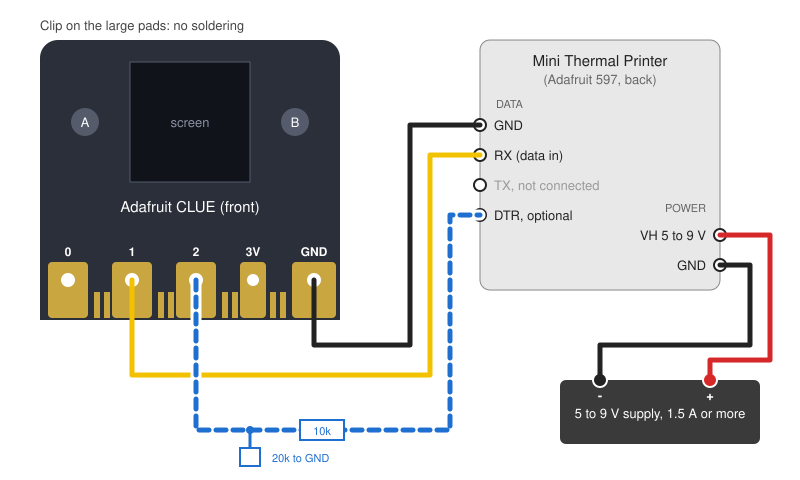

# CLUE QR Printer

Send a text to the Adafruit CLUE, from the shell or from a phone over BLE:
the board shows its QR code on the screen and prints it on the Mini
Thermal Receipt Printer of Adafruit, with the text below it. Button A
prints the last code again.

The code is made on the board by the
[QR Code generator](https://github.com/nayuki/QR-Code-generator) package
and printed as an image: the printer has no QR code command of its own.

## Wiring

| Wire            | From                              | To                          |
|-----------------|-----------------------------------|-----------------------------|
| yellow, data    | CLUE pad 1 (TX, P0.05)            | printer RX (data in)        |
| black, ground   | CLUE pad GND                      | printer GND of the data connector |
| blue, optional  | CLUE pad 2 (P0.03), see below     | printer DTR                 |
| red, power      | supply +, 5 to 9 V, 1.5 A or more | printer VH                  |
| black, power    | supply -                          | printer GND of the power connector |

The colors are the ones of the drawing, the cable of the printer may have
others: follow the labels of its connectors.

No soldering: the large pads 0, 1, 2, 3V and GND of the CLUE have holes
for alligator clips, use clips with a male jumper pin at the other end
for the connectors of the printer. A micro:bit edge connector breakout
also fits, the CLUE has the edge connector of the micro:bit.

The data wire needs no level shifter: the printer reads 3.3 V levels. Its
TX pin stays unconnected, the board only sends.

Never power the printer from the CLUE: it draws well over 1 A while
printing. Its own supply and the CLUE share the ground through the printer.

DTR is optional, it makes the long codes print faster: connect it only
through the divider of the drawing, 10 kOhm in series and 20 kOhm from
pad 2 to GND, the printer may drive it at 5 V and the pins of the CLUE take
at most 3.6 V. Then build with `PRINTER_DTR='GPIO_PIN(0,3)'`.

Hold the button of the printer while powering it to print its test page:
it gives its baud rate, 19200 by default here, else set
`PRINTER_BAUDRATE=9600`.

Without DTR the board waits after each part of the image for the time the
printer takes to print it, the timings of the Arduino library of Adafruit:
a code of 512 bytes takes about 10 s.

## Build and flash

    make RIOTBASE=<RIOT tree with the demo-apps branch> flash term

## Send a text

From the shell, over USB:

    > qr https://www.riot-os.org/
    queued 24 bytes
    Printing 24 bytes
    Printed, version 2

The shell splits the line at the spaces and the command joins the words
with one space: quote the text to keep several spaces, `qr 'a  b'`.

Over BLE, the board advertises as `CLUE QR Printer`. Write the text, in
UTF-8, to the text characteristic, with nRF Connect for example:

Service `5a7e0001-3c1d-4e8b-9f2a-7b6c4d1e0f90`, characteristics
`5a7e00XX-...` with:

| XX | Access       | Content                                                    |
|----|--------------|------------------------------------------------------------|
| 02 | write        | the text to print, UTF-8, 1 to 512 bytes                   |
| 03 | read, notify | state (u8: 0 ready, 1 printing), longest text (u16, little endian) |

A write while the printer prints fails with the ATT error 0x80, an empty
text or one with a null byte with 0x81.

No pairing: anyone near the board can print.

## Length of the text

At most 512 bytes, from both sources: the longest value of a BLE
attribute. Then the code is a version 15 (77 modules) with the low error
correction.

The limit of the printer itself is a bit higher: its head has 384 dots,
8 per mm. With modules of 4 dots (0.5 mm, read by any phone) and the
quiet zone of 4 modules on each side, the largest code is a version 17
(85 modules), up to 644 bytes. Shorter texts get larger modules, up to
8 dots, and a higher error correction when it fits in the same version.

Texts of up to 96 printable ASCII characters are printed below the code,
the others only by their length: the font of the printer is code page 437.

## Test on native

The application also builds for `native64`, with the shell only, the
printer on a pseudo terminal. The test sends texts, decodes the bytes sent
to the printer, checks the layout and the timing of the image and reads
the codes back with zxing-cpp:

    .venv/bin/pip install zxing-cpp pillow
    make BOARD=native64 RIOTBASE=<RIOT tree with the demo-apps branch>
    .venv/bin/python tests/native/run.py

## Hardware notes

Not run on hardware yet. Things to check first:

- the timings: with missing or shifted rows in the codes, connect DTR, or
  raise `ADAFRUIT_THERMAL_PARAM_DOT_PRINT_US` (30000 us by default)
- the darkness: `ADAFRUIT_THERMAL_PARAM_HEAT_TIME` (120 by default, darker
  and slower when higher)
- long BLE writes from the phone (more than the MTU, prepared writes)
